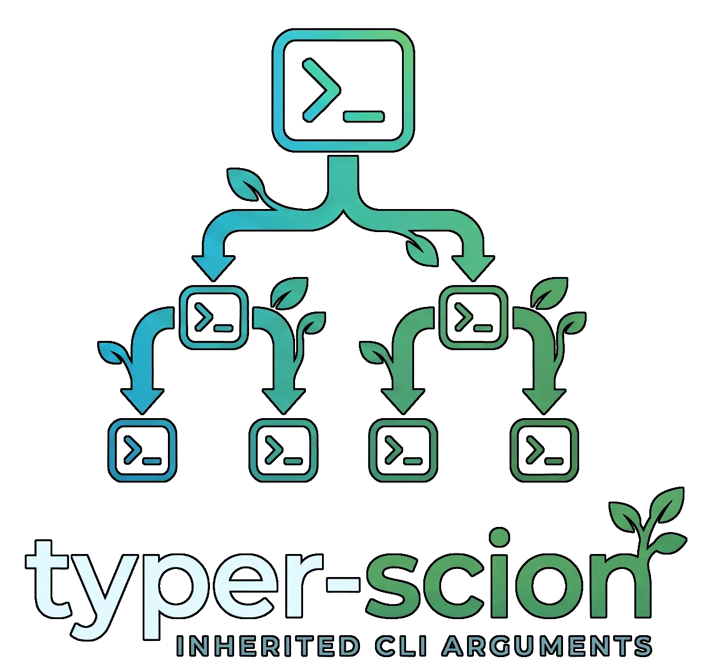

[](https://pypi.org/project/typer-scion/)
[](https://www.python.org/)
[](https://github.com/dusktreader/typer-scion/actions/workflows/main.yml)
[](https://dusktreader.github.io/typer-scion/)



_Enable typer subcommands to inherit common options from their parent commands._

Do you ever get frustrated that flags defined on parent groups can't be set in child commands? I do! I hate having to
write commands like `my-app --verbose do thing` when I want to write `my-app do thing --verbose`.

There are issues and discussions on the [typer github repo](https://github.com/fastapi/typer/issues/153) talking about
this missing feature, but I didn't find the solutions satisfying.

So, I made `typer-scion`.


## Super-quick Start

Requires: Python 3.11 to 3.15

Install through pip:

```shell
pip install roadshow
```

Or, `uv`:

```shell
uv add typer-scion
```


## Documentation

The complete documentation can be found at the
[typer-scion home page](https://dusktreader.github.io/typer-scion)


## Demo

To see the features in action, you can run the demo in an isolated environment with `uvx`:

```shell
uvx --from typer-scion typer-scion-demo
```
