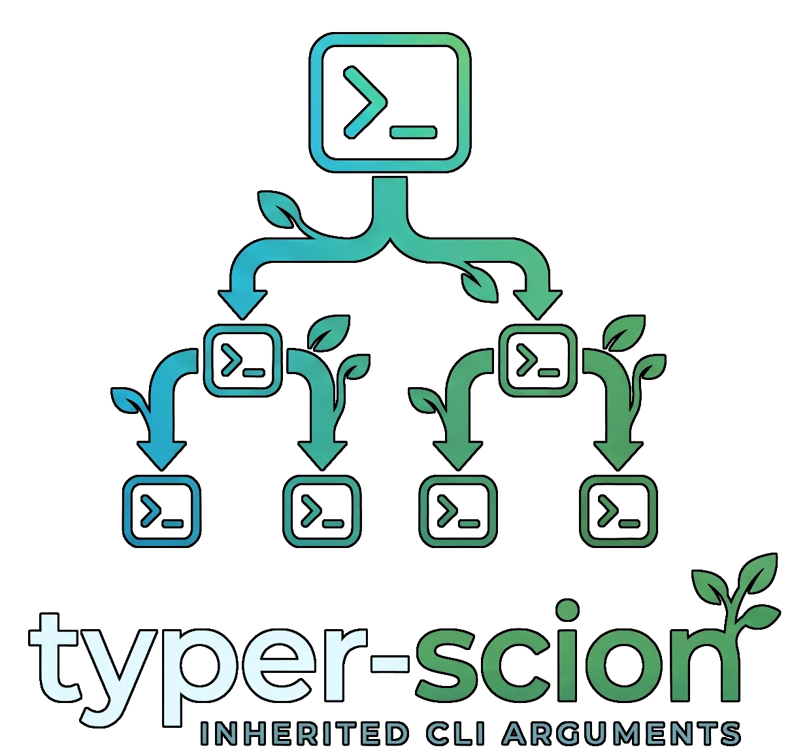

_Enable typer subcommands to inherit common options from their parent commands._

Do you ever get frustrated that flags defined on parent groups can't be set in child commands? I do! I hate having to
write commands like `my-app --verbose do thing` when I want to write `my-app do thing --verbose`.

There are issues and discussions on the [typer github repo](https://github.com/fastapi/typer/issues/153) talking about
this missing feature, but I didn't find the solutions satisfying.

So, I made `typer-scion`.

## Overview

Typer lets a group callback declare options, but those options belong to the group. If you define a `---verbose`
option to the group to set up logging, then running `app --verbose cmd` works. However, running `app cmd --verbose` will
fail with `typer` complaining about no such option. `ltyper-scion` lets you declare an option once, on a parent
callback, and have any subcommand that opts in accept it too. Here's how:

1. Mark an option with `Inheritable()` on the parent callback
2. Opt a command in with `@inherit`
3. Receive the value by name with `Inherited()`, as `**kwargs`, or from `get_inherited()`
4. Inherited options appear in the child's `--help`, in their own panel

## Explore

- [Quickstart](quickstart.md)
- [Features](features.md)
- [API reference](reference.md)
